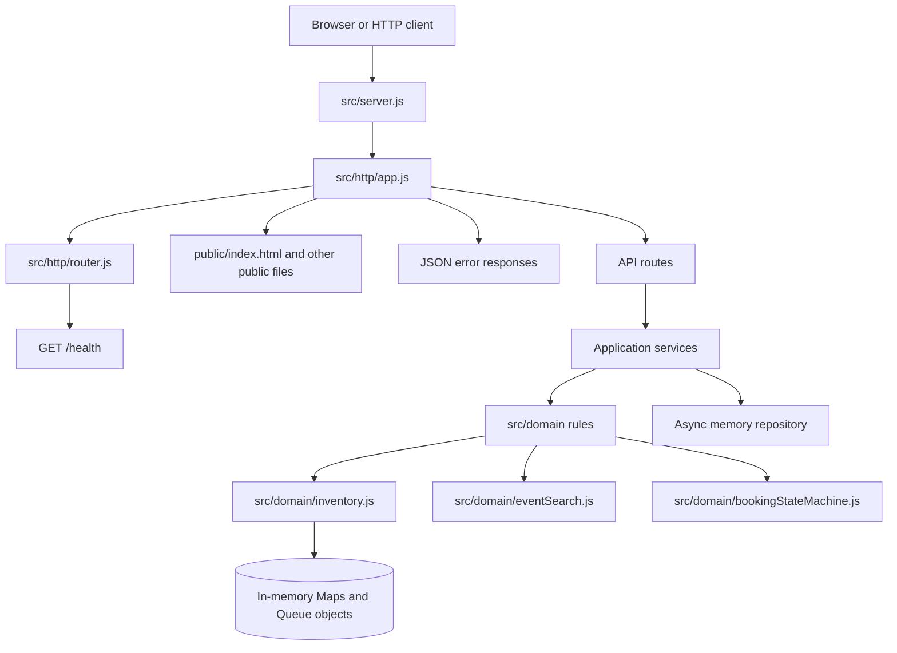
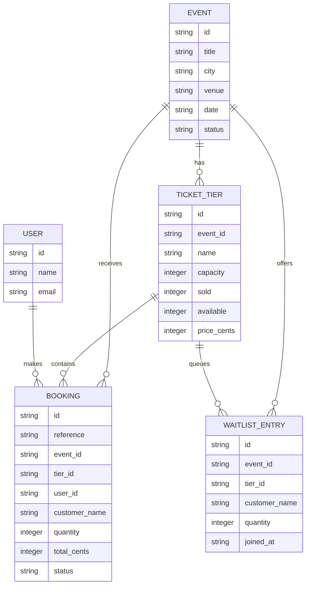
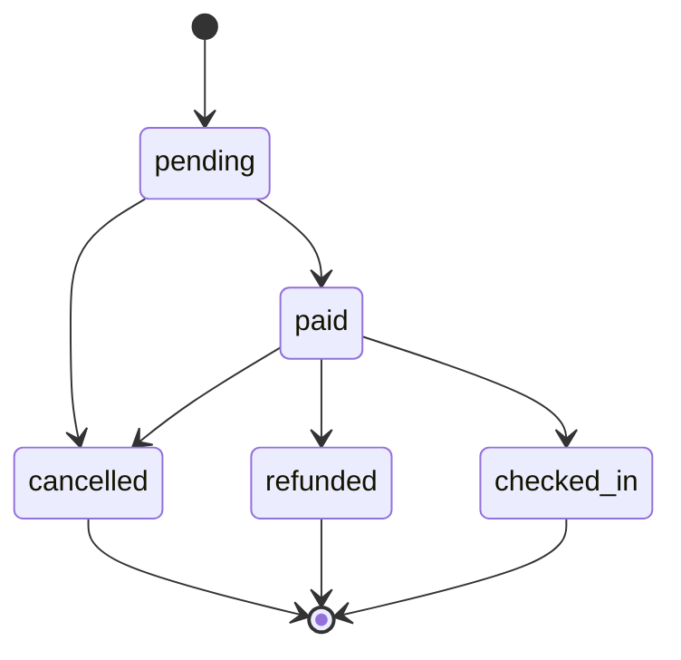

# Event Ticketing architecture

This document describes the project as it exists at the end of Build 4. The
application is a plain JavaScript ES-module project for Node.js 22.13 or
newer. It uses an in-memory repository and a working REST API.

## Project structure

```text
src/
├── config.js                         PORT configuration
├── server.js                         Node HTTP server entry point
├── repositories/
│   └── memory.js                     async in-memory repository
├── services/
│   ├── eventService.js               event rules and search use cases
│   └── bookingService.js             booking and payment use cases
├── lib/
│   └── mockPaymentGateway.js         mock payment adapter
├── domain/
│   ├── errors.js                     DomainError and error codes
│   ├── ids.js                        secure IDs and booking references
│   ├── waitlistQueue.js              linked-list FIFO queue
│   ├── inventory.js                  events, tiers, bookings, and waitlists
│   ├── sorting.js                    stable merge sort
│   ├── eventSearch.js                pure event filtering and sorting
│   └── bookingStateMachine.js        booking lifecycle rules
└── http/
    ├── router.js                     method and parameter route matching
    └── app.js                        HTTP responses and static files

public/
└── index.html                         current static landing page
```

## Layers and current request flow



- **HTTP entry point (`src/server.js`)** starts `node:http` with the configured
  port; it may start the server but may not contain business rules.
- **HTTP application and routes (`src/http/app.js` and `router.js`)** parse
  requests, match methods and `:params`, serve `public/`, and format responses;
  they may not decide ticket, booking, or payment policy.
- **Application services (`src/services/`)** coordinate API use cases and call
  domain rules and repositories; they do not know HTTP details.
- **Domain rules (`src/domain/`)** validate input and enforce inventory,
  searching, sorting, queue, error, and booking-state rules; they must not
  depend on HTTP.
- **Repository/data (`src/repositories/memory.js`)** provides async event,
  tier, and booking operations over in-memory `Map` objects. It does not own
  business policy.

## Data model



### Current data behavior

- `createStore()` creates in-memory `Map` objects for events and bookings.
- Events begin as `DRAFT` and become `PUBLISHED` through `publishEvent()`.
- Ticket tiers store money as whole `priceCents` and track `capacity`, `sold`,
  and `available`.
- `bookTickets()` creates `PENDING` bookings and stores them by reference for
  O(1)-average lookup with `Map.get()`.
- `cancelBooking()` releases the seats and rejects a second cancellation.
- Each tier has a linked-list `Queue` for FIFO waitlist entries.
- There is not yet a user or authentication model; `customerName` is the
  current booking identity. Users are planned for a later build.
- Build 4 identifies callers with the `x-user-id` request header; it does not
  yet implement accounts or authentication.

## Booking life cycle



The lifecycle is represented as data in
`src/domain/bookingStateMachine.js`. `canTransition(from, to)` returns whether
a move is allowed, while `assertTransition(from, to)` throws a
`DomainError` with `INVALID_TRANSITION` for an illegal move. `cancelled`,
`refunded`, and `checked_in` are final states.

The current Build 1/2 inventory implementation still uses the booking status
values `PENDING`, `CONFIRMED`, and `CANCELLED`; the state machine provides the
lowercase lifecycle contract that later payment, refund, expiry, and
check-in services will adopt.

## HTTP behavior delivered in Build 4

| Request | Current result |
|---|---|
| `GET /` | Serves `public/index.html` |
| `GET /health` | Returns `{"status":"ok"}` |
| `POST /api/events` | Creates a draft event |
| `POST /api/events/:id/tiers` | Adds a ticket tier |
| `POST /api/events/:id/publish` | Publishes an event |
| `GET /api/events` | Searches published events |
| `POST /api/bookings` | Creates a pending booking |
| `POST /api/bookings/:reference/pay` | Pays with the mock gateway |
| `POST /api/bookings/:reference/cancel` | Cancels an unpaid booking |
| Unknown `/api/...` path | JSON `404` with `{ "error": { "code", "message" } }` |
| Invalid JSON request body | JSON `400` with the same error shape |
| Missing public file | JSON `404` |
| Path attempting to escape `public/` | Rejected with JSON `404` |

All unexpected server errors return a generic JSON `500` response. Stack
traces are not sent to clients.
