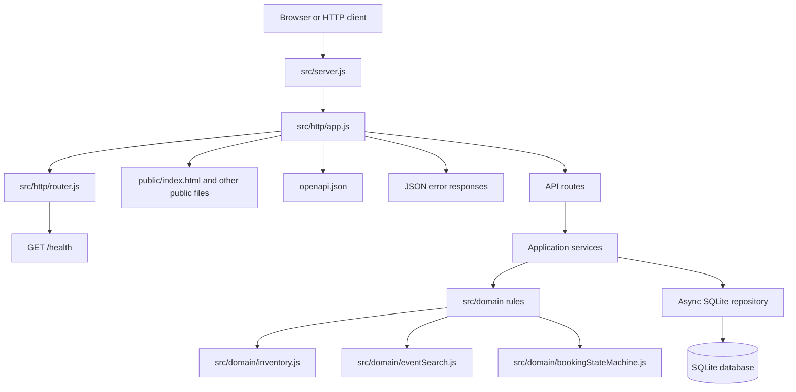
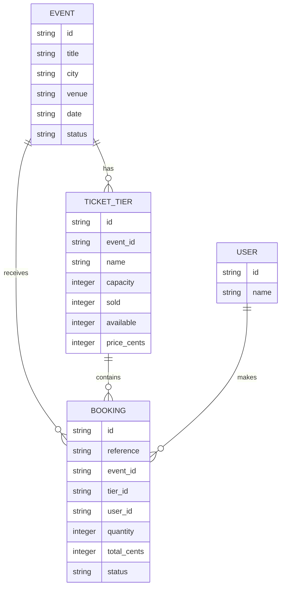
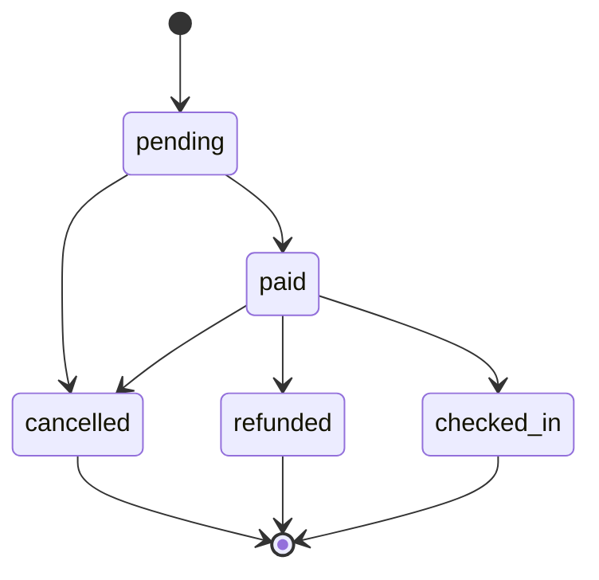

# Event Ticketing architecture

This document describes the project as it exists at the end of Build 5. The
application is a plain JavaScript ES-module project for Node.js 22.13 or
newer. It uses a SQLite repository, a working REST API, and an in-memory
repository for isolated tests.

## Project structure

```text
src/
├── config.js                         PORT configuration
├── server.js                         Node HTTP server entry point
├── repositories/
│   ├── memory.js                     async in-memory repository for tests
│   └── sqlite.js                     async SQLite repository
├── db/
│   ├── connection.js                 SQLite connection and schema setup
│   └── schema.sql                    relational constraints
├── services/
│   ├── eventService.js               event rules and search use cases
│   └── bookingService.js             booking and payment use cases
├── lib/
│   └── mockPaymentGateway.js         mock payment adapter
├── domain/
│   ├── errors.js                     DomainError and error codes
│   ├── ids.js                        secure IDs and booking references
│   ├── waitlistQueue.js              linked-list FIFO queue
│   ├── inventory.js                  events, tiers, bookings, and waitlists
│   ├── sorting.js                    stable merge sort
│   ├── eventSearch.js                pure event filtering and sorting
│   └── bookingStateMachine.js        booking lifecycle rules
└── http/
    ├── router.js                     method and parameter route matching
    └── app.js                        HTTP responses and static files

public/
├── index.html                         current static landing page
└── docs.html                          Scalar API documentation page

scripts/
├── demo.js                            Build 1 terminal demonstration
├── benchmark-lookup.js                Map versus Array.find benchmark
├── seed.js                            repeat-safe SQLite seed script
└── oversell-demo.js                   concurrent last-seat demonstration

test/
├── build-2.test.js                    domain and search tests
├── build-3.test.js                    state machine, router, and HTTP tests
├── build-4.test.js                    API booking and payment tests
├── event-api-extra.test.js            event viewing and unpublishing tests
└── oversell.test.js                   concurrent SQLite reservation test

data/
└── ticketing.sqlite                   persistent SQLite database
```

## Layers and current request flow



- **HTTP entry point (`src/server.js`)** starts `node:http` with the configured
  port; it may start the server but may not contain business rules.
- **HTTP application and routes (`src/http/app.js` and `router.js`)** parse
  requests, match methods and `:params`, serve `public/`, and format responses;
  they may not decide ticket, booking, or payment policy.
- **Application services (`src/services/`)** coordinate API use cases and call
  domain rules and repositories; they do not know HTTP details.
- **Domain rules (`src/domain/`)** validate input and enforce inventory,
  searching, sorting, queue, error, and booking-state rules; they must not
  depend on HTTP.
- **Repository/data (`src/repositories/sqlite.js`)** provides async event,
  tier, and booking operations over SQLite. It does not own business policy.
  The memory repository remains available for isolated tests, and the server
  uses SQLite through `src/server.js`.
- **Database (`src/db/`)** owns the schema, foreign keys, uniqueness rules and
  ticket-inventory constraints. Last-seat reservation uses one atomic
  conditional `UPDATE` and the changed-row count. All repository SQL uses
  placeholders for values.

## Data model



### Current data behavior

- The server opens the SQLite database at `data/ticketing.sqlite`; the
  repository data survives closing and reopening the database.
- Events begin as `DRAFT` and become `PUBLISHED` through the event service.
- Ticket tiers store money as whole `priceCents` and track `capacity`, `sold`,
  and `available`.
- The Build 1 domain store uses `Map` for events and bookings, while the
  SQLite repository stores events, tiers, users, and bookings in tables.
- Build 4 identifies callers with the `x-user-id` request header; Build 5
  inserts that ID into `users` to satisfy the booking foreign key. Accounts
  and authentication are not implemented.
- The linked-list waitlist exists only in the in-memory domain model and
  terminal demo. It is not persisted in SQLite or exposed as an API route.
- The booking service currently allows a booking lookup by event and tier
  without checking that the event status is `PUBLISHED`; this is an open
  alignment issue against the published-event booking requirement.
- The SQLite booking statuses are `PENDING`, `PAID`, and `CANCELLED`.
  Refund, expiry, and check-in statuses exist in the separate state-machine
  contract but are not implemented as services.

## Booking life cycle



The lifecycle is represented as data in
`src/domain/bookingStateMachine.js`. `canTransition(from, to)` returns whether
a move is allowed, while `assertTransition(from, to)` throws a
`DomainError` with `INVALID_TRANSITION` for an illegal move. `cancelled`,
`refunded`, and `checked_in` are final states.

The inventory and SQLite implementations currently use the booking status
values `PENDING`, `PAID`, and `CANCELLED`; the state machine provides the
lowercase lifecycle contract for later refund, expiry, and check-in services.

## HTTP behavior delivered through Build 5

| Request | Current result |
|---|---|
| `GET /` | Serves `public/index.html` |
| `GET /health` | Returns `{"status":"ok"}` |
| `POST /api/events` | Creates a draft event |
| `POST /api/events/:id/tiers` | Adds a ticket tier |
| `GET /api/events/:id` | Views an event |
| `POST /api/events/:id/publish` | Publishes an event |
| `POST /api/events/:id/unpublish` | Returns an event to draft status |
| `GET /api/events` | Searches published events |
| `POST /api/bookings` | Creates a pending booking |
| `POST /api/bookings/:reference/pay` | Pays with the mock gateway |
| `POST /api/bookings/:reference/cancel` | Cancels an unpaid booking |
| `GET /openapi.json` | Returns the OpenAPI specification |
| Unknown `/api/...` path | JSON `404` with `{ "error": { "code", "message" } }` |
| Invalid JSON request body | JSON `400` with the same error shape |
| Missing public file | JSON `404` |
| Path attempting to escape `public/` | Rejected with JSON `404` |

All unexpected server errors return a generic JSON `500` response. Stack
traces are not sent to clients.

## Build 5 concurrency behavior

`reserveSeats()` in `src/repositories/sqlite.js` executes one conditional
`UPDATE`:

```sql
UPDATE ticket_tiers
SET sold = sold + ?
WHERE id = ? AND event_id = ? AND sold + ? <= capacity
```

If SQLite reports zero changed rows, the repository throws `SOLD_OUT`.
The Build 5 demo and test send 50 concurrent booking attempts after one
setup booking has left one seat available. Exactly one attempt succeeds, 49
return `SOLD_OUT`, and the final sold count remains within capacity.

The current automated suite does not include a server-restart persistence
test; persistence has been verified by closing and reopening the database.
