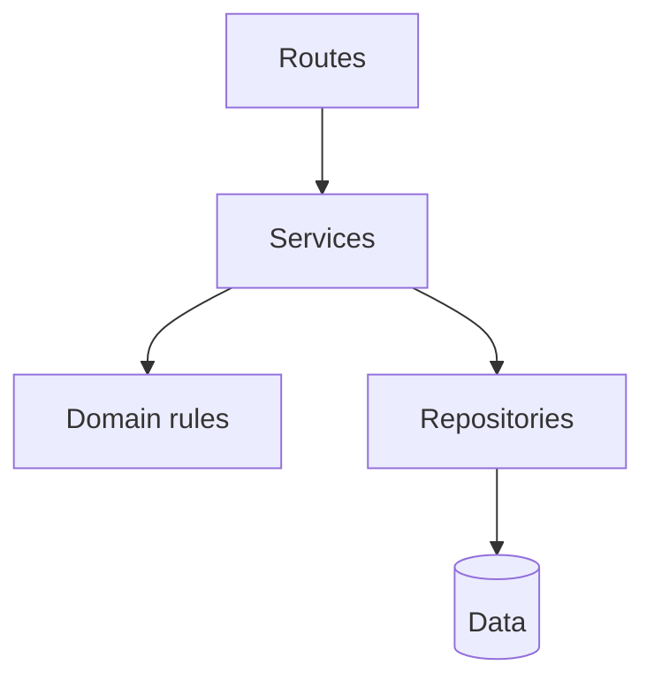
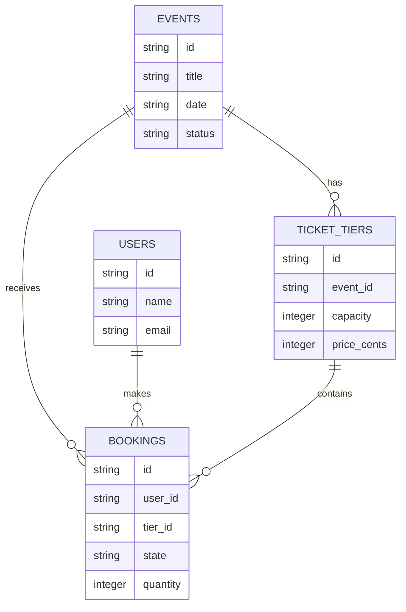
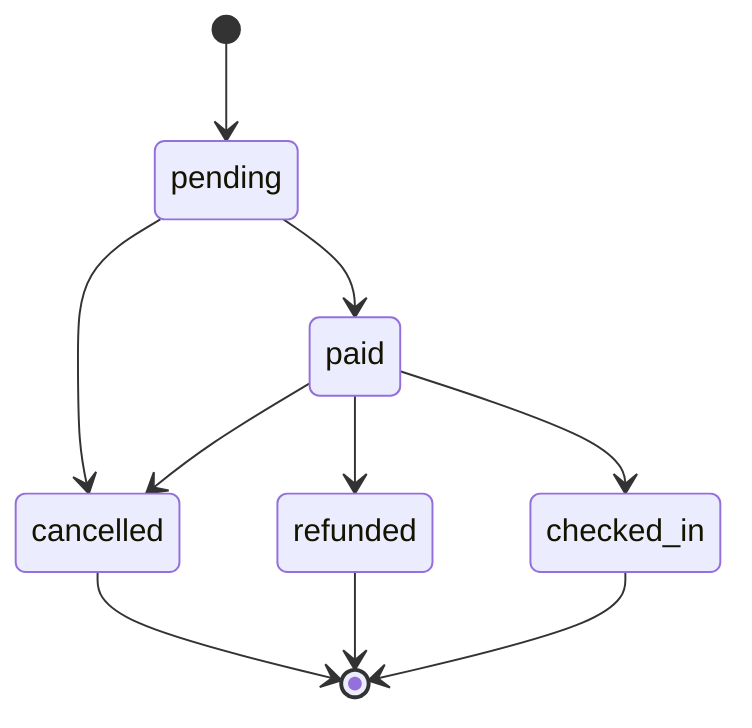

# Build 3 architecture

## Layers

- **Routes** may translate HTTP requests and responses, but may not contain business rules or access data directly.
- **Services** may coordinate use cases and call rules and repositories, but may not know HTTP details.
- **Rules** may enforce domain invariants, but may not call routes, services, or repositories.
- **Repositories** may load and store data, but may not decide business policy or call upward layers.
- **Data** may hold persisted state, but may not depend on application layers.

## Data model

## Booking life cycle

